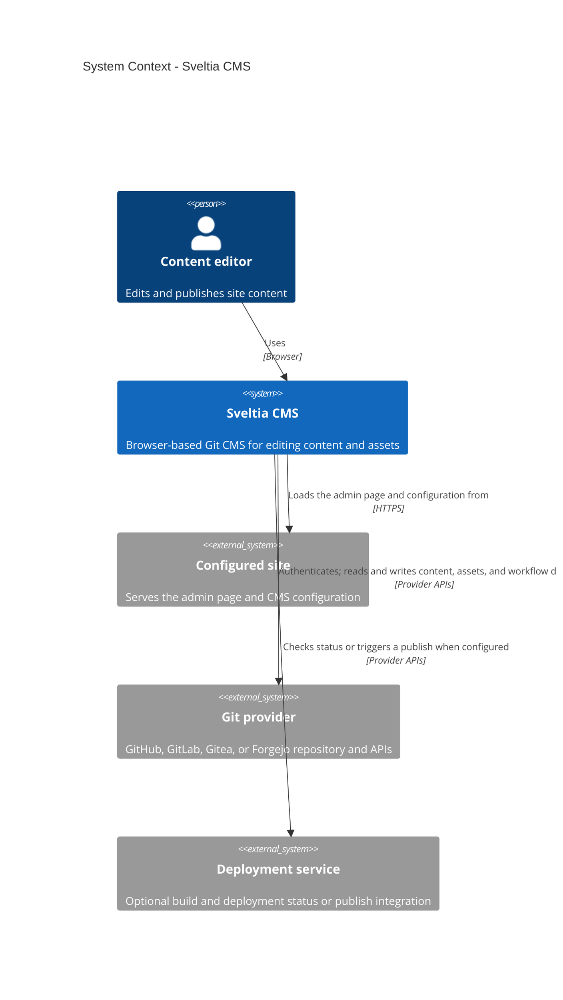
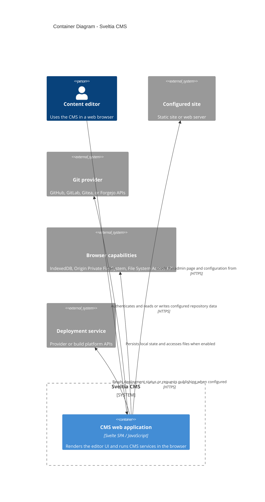
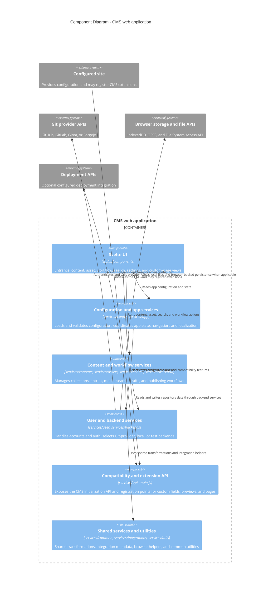
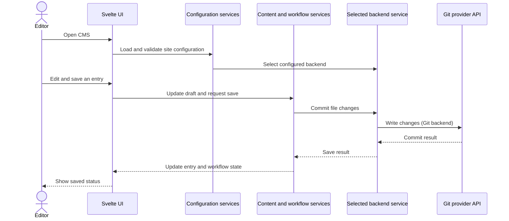

# Architecture

Sveltia CMS is a browser-based, single-page application. Its UI and business logic run in the
browser; it loads site configuration and accesses content through the backend selected in that
configuration. The diagrams below describe the current implementation, not a required deployment
topology.

## C4 level 1: System context

The configured site and content repository may be the same project or separate projects. Deployment
integrations are optional and depend on the configured provider and workflow.

## C4 level 2: Container

The published CMS bundle is static; there is no Sveltia CMS application server in the content
editing request path. In local-backend mode, browser file APIs provide the local working copy, with
a configured Git provider used for the remote repository operations.

## C4 level 3: Components

## Source map

| Area | Entry points |
| --- | --- |
| Browser bundle and public API | `src/lib/main.js`, `src/lib/services/api/` |
| Svelte application and pages | `src/lib/components/` |
| Configuration and app lifecycle | `src/lib/services/config/`, `src/lib/services/app/` |
| Content, media, search, and workflows | `src/lib/services/contents/`, `assets/`, `search/`, `workflow/` |
| Authentication and provider backends | `src/lib/services/user/`, `src/lib/services/backends/` |
| Deployment integrations and shared helpers | `src/lib/services/deployments/`, `integrations/`, `common/`, `utils/` |
| Localization and shared types | `src/lib/locales/`, `src/lib/types/` |

## Important abstractions

The code is organized around a few contracts that let the UI and domain logic avoid depending on a
specific provider or file format.

| Abstraction | Contract and purpose | Where to look |
| --- | --- | --- |
| Public compatibility and extension API | `CMS`, `init()`, and registration methods preserve the Netlify/Decap CMS integration surface and let sites add fields, previews, pages, formats, and transformations. | `src/lib/main.js`, `src/lib/services/api/index.js`, `src/lib/services/api/registries.js` |
| Backend service | The internal `BackendService` contract standardizes sign-in, file loading, commits, and optional Git/workflow operations. `selectBackend()` chooses and initializes the implementation from site configuration. | `src/lib/types/private.js`, `src/lib/services/backends/index.js` |
| Shared Git backend services | Provider modules supply their URLs, auth details, and provider-specific API operations; shared Git services handle common API, auth, repository, and workflow behavior. | `src/lib/services/backends/git/{github,gitlab,gitea,shared}/` |
| Browser-local repository | The local backend implements the same file and save workflow using browser file-system handles, optionally wrapping a configured Git provider for remote operations. | `src/lib/services/backends/fs/local.js`, `src/lib/services/backends/fs/shared/`, `src/lib/services/backends/fs/git/` |
| Content file formats | Parsers and formatters convert repository files to/from entry data. Built-in and registered custom formats are selected through configuration and the format registry. | `src/lib/services/contents/file/`, `src/lib/services/api/registries.js` |
| External services | Deployment, media library, and other integrations are expressed through service-specific configuration and capabilities rather than being part of the editor UI itself. | `src/lib/services/deployments/`, `src/lib/services/integrations/`, `src/lib/types/private.js` |

These are architectural seams, not a promise that every provider or integration supports every
optional capability. Check the relevant service contract and current implementations before adding
or assuming support.

## Typical data flow

In the local backend, the save targets browser-accessible files instead; a Git commit is optional
and uses the configured remote Git service when one is available.

## Extending the CMS

There is no plugin API for backends or deployment providers; both are extended by changing the
core. Paths below are under `src/lib/`.

### Adding a Git service

Bitbucket and Azure DevOps are listed in `unsupportedBackends` in `services/backends/index.js`.
To add a service like these:

1. **Types.** Add the name to `GitBackendName` and a backend configuration typedef in
   `types/public.js`. The published JSON schema is generated from these types.
2. **Provider module.** Create `services/backends/git/<name>/`, modelled on `gitea/` or `gitlab/`.
   Its `index.js` default-exports a `BackendService` (defined in `types/private.js`):
   - Required: `isGit`, `name`, `label`, `repository`, `init`, `signIn`, `signOut`, `fetchFiles`,
     `commitChanges`.
   - Optional for Git services: `fetchLastCommit`, `fetchBlob`, `fetchDirSHA`, `fetchFileCommits`.
   - Optional features: `workflow` (Editorial Workflow and Open Authoring), `fetchBranchHeadSHA`,
     `fetchDeployments`, `triggerDeployment`, `checkStatus`.
   - Existing providers split the work into `api`, `auth`, `files`, `commits`, `user`,
     `repository`, `fork`, `workflow`, `pull-requests` and `deployment` modules.
3. **`init()`.** Read `cmsConfig.current.backend` and call `initGitBackend()`
   (`services/backends/git/shared/init.js`), which fills in the repository info, the OAuth
   authorization and token URLs, and the REST/GraphQL endpoints.
4. **Shared plumbing.** Reuse `services/backends/git/shared/` (`api.js`, `auth.js`, `fetch.js`,
   `tree.js`, `file-cache.js`, `fork.js`, `workflow.js`, `pull-requests.js`) rather than
   duplicating it.
5. **Registration.** Add the service to `gitBackendServices` in `git/services.js`, which wraps it
   with `scopeBackendService` to support `root_dir`, and remove it from `unsupportedBackends`.
   `validBackendNames` is derived from the registered services.
6. **Configuration and sign-in.** Update `services/config/parser/backend.js` (validation,
   defaults, documentation slug) and `services/user/sign-in-options.js`.
7. **Service-specific branches.** Some shared modules test for a particular service, for example
   PKCE in `shared/auth.js`, the pull request helpers in `shared/workflow.js`, skip-CI markers in
   `shared/commits.js`, and `backends/branch-access.js`. Review them for the new service.
8. **Tests.** Add co-located unit tests; the project enforces full unit-test coverage.

### Supporting a new builder or CI/CD provider

The CMS does not run builds. It reads build results from the Git service, so many providers need
little or no code.

- Each provider's `deployment.js` turns commit statuses, check runs or deployments into
  `DeployCandidate` objects. `services/backends/git/shared/deployment.js` chooses one
  (`pickDeployment`, `resolveDeployments`) and validates its URL.
- A provider is recognised by name through `PREVIEW_NAME_REGEX`, or explicitly by the user's
  `preview_context` backend option. Supporting a new builder is often a regex addition.
- Skip-CI markers for commits are defined in `services/backends/git/shared/commits.js`.
- A manual deployment uses the user's deploy hook URL, or the backend's `triggerDeployment` if it
  has one (`services/deployments/publish.js`). GitHub and GitLab implement it; Gitea and Forgejo
  do not.
- A builder that reports status somewhere other than the Git service has no extension point and
  needs new core code.

## Preview customization

The default preview is rendered by Svelte:

- `components/contents/details/preview/entry-preview.svelte` renders each field through
  `field-preview.svelte`.
- The per-field components are `components/contents/details/fields/<type>/<type>-preview.svelte`,
  mapped by the `previews` object in `fields/index.js`.

Sites can customize it in three ways:

| API | Effect | Where it lives |
| --- | --- | --- |
| `CMS.registerPreviewStyle()` | Keeps the Svelte preview but renders it in an iframe with the registered stylesheets, optionally limited to a collection or file. | `services/api/methods/register-preview-style.js`, `services/contents/editor/preview-styles.js`, `preview-frame.js` |
| `CMS.registerPreviewTemplate(name, Component)` | Replaces the preview of a collection or file with a React component rendered in the iframe. The component receives Immutable Maps, and `widgetFor()` mounts the built-in Svelte field previews into it. | `services/api/methods/register-preview-template.js`, `services/api/registries.js`, `services/contents/editor/preview-templates.js`, `components/contents/details/preview/entry-preview-iframe.svelte` |
| `CMS.registerFieldType()` | Adds a custom field type with its own control and preview. | `services/api/field-types.js`, `components/contents/details/fields/custom/` |

React and Immutable are loaded lazily, so a site that registers no template does not load them.

## Language, types, and build

Application source is JavaScript (`.js`) and Svelte (`.svelte`), not TypeScript source. Types are
written as TypeScript-flavoured JSDoc, with public CMS/configuration types in
`src/lib/types/public.js` and internal contracts in `src/lib/types/private.js`. `jsconfig.json`
enables strict `checkJs` checking and maps `$lib` to `src/lib`; `pnpm check:svelte` runs
`svelte-check` over the Svelte and JavaScript sources. During the production build, TypeScript's
compiler emits declaration files from the documented JavaScript API, and the build generates the
published CMS configuration JSON schema from the public types.

Vite builds the browser entry at `src/lib/main.js` into `package/dist/sveltia-cms.js` (IIFE) and
`package/dist/sveltia-cms.mjs` (ES module). The Git, QR code, and React DOM modules are separate
on-demand chunks under `package/dist/chunks/`. The build also assembles the npm package and its
types, schema, and locale assets. `package/` is generated output; make source changes under `src/`
or build scripts/configuration rather than editing built files.

## Developing and validating changes

Use the Node version in `.nvmrc` and pnpm. After installing dependencies with `pnpm install`, run
`pnpm dev` for the Vite development server. Tests are colocated as `*.test.js`: unit tests run under
Vitest's `unit` project, Svelte component tests run in Chromium under its `browser` project, and
cross-module browser flows live in `e2e/specs/` and use Playwright against the production bundle.
Useful checks are `pnpm check:svelte`, `pnpm check:eslint`, `pnpm check:prettier`, `pnpm test:unit`,
and `pnpm test:components`; run `pnpm build` before end-to-end tests. `pnpm check` and `pnpm test`
run the broader local suites.

Prefer putting behavior in a service module and testing it with unit tests; component tests should
cover the remaining markup, accessibility, bindings, and events. Use an end-to-end test when the
behavior crosses module or backend boundaries. For provider, storage, or public API changes, follow
an existing implementation and its tests so the contract remains consistent. See
[`CONTRIBUTING.md`](../CONTRIBUTING.md) for the repository's current contribution policy and
project guidance.
